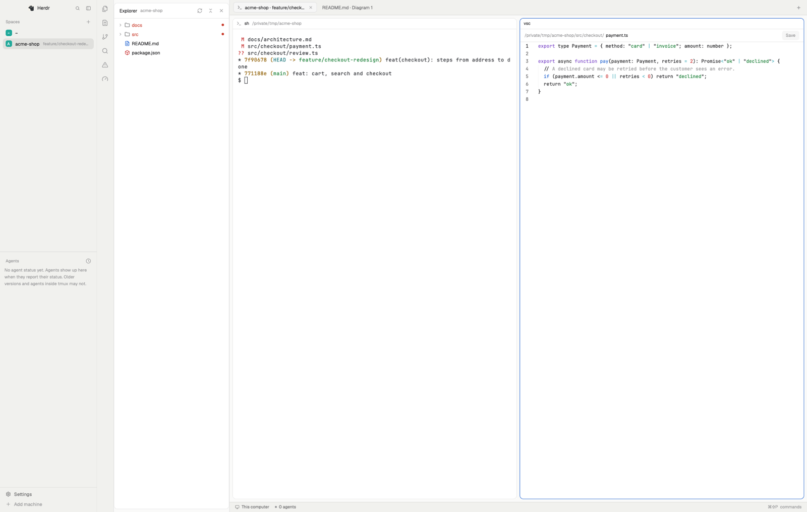
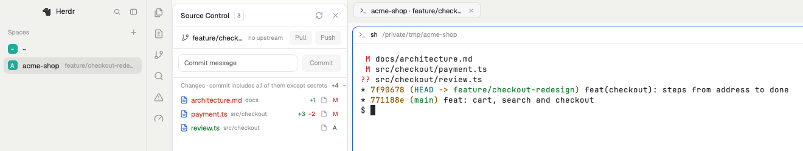
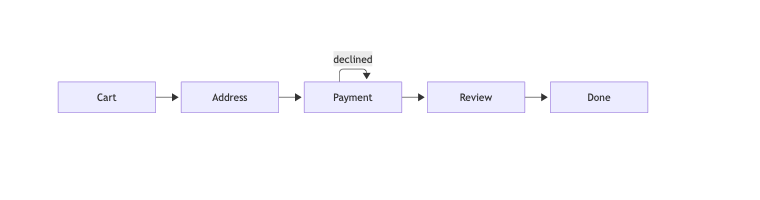
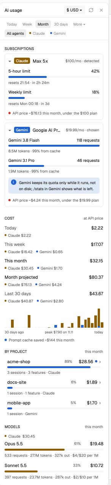
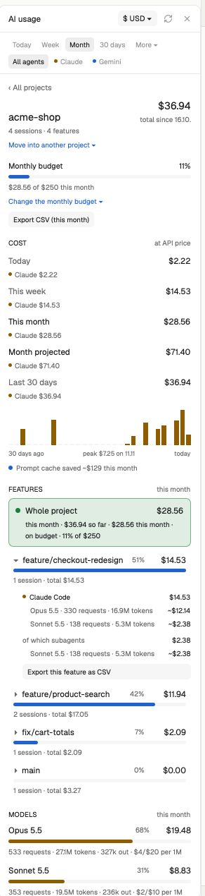
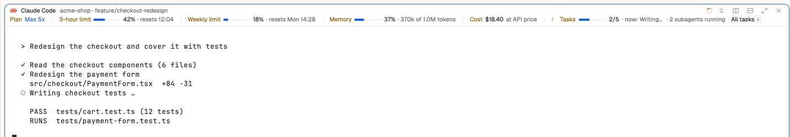
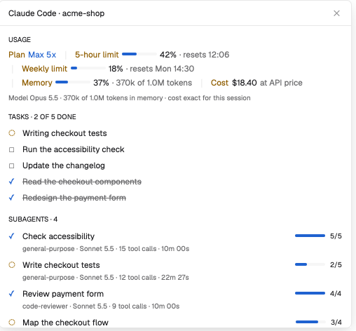
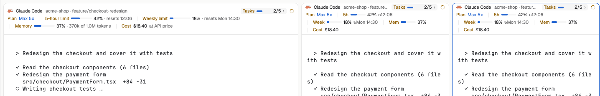
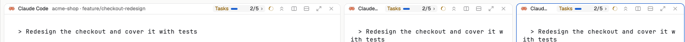

# Herdr Workspace Studio

An editor workbench for the [Herdr](https://herdr.dev) app, plus a view of what your coding agents cost.
It works in the style of VS Code but isn't affiliated with Microsoft or Visual Studio Code.



| Part | What it gives you |
| --- | --- |
| **Workspace layout** | Explorer, Source Control, Search, Problems and editor tabs next to your terminals |
| **AI usage panel** | Subscriptions and limits, cost by day, project, feature and model, for Claude Code, Gemini CLI and Codex |
| **Agent tracker** | Each pane running Claude Code, Codex or Gemini CLI shows its plan, limits, memory, cost and tasks, and fits itself to the pane |
| **Claude Code progress tracker** | Tasks and subagents with progress bars inside Claude Code, above its prompt |

Runs on macOS and Linux and needs Herdr 0.1.14 or newer. The AI usage panel also needs Node 20+.

## Workspace layout

- **Explorer:** a file tree with git marks and a VS Code-style right-click menu.
- **Source Control:** commit, switch branches, pull and push. Secrets are never committed or pushed.
- **Search and Quick Open:** search and replace across the folder (`cmd-shift-f`), or jump to a file by name (`cmd-p`).
- **Problems:** TypeScript, ESLint and Ruff results from the project's own tools, once you trust the folder.
- **Editor tabs:** code with syntax colors, Markdown, images, PDFs and Office documents, and diagrams (Mermaid, draw.io, Excalidraw, PlantUML).





Every feature in detail: [docs/workspace.md](docs/workspace.md).

## AI usage panel

Open it with the gauge icon at the bottom of the rail.

<p>
  
  &nbsp;
  
</p>

- **Subscriptions:** your Claude plan is detected, along with its 5-hour and weekly limits and when they reset. For Gemini and Codex you pick the plan yourself. Each card shows whether the plan beats paying per token.
- **Cost:** today, this week, this month, the month projected, and 30 days up to all time, with a chart by day and what the prompt cache saved. Amounts are at API list price, in dollars or euros (ECB rate).
- **Projects and features:** click a project to see its total so far, its git branches as features, and inside each feature its agents, models and subagents. You can set a monthly budget, which warns you at 80% and 100%, and export a CSV.
- **Models:** every model you use, compared side by side, from all agents.

Everything comes from each agent's own logs on your computer. Usage figures only, nothing is sent anywhere.

## Agent tracker

Every pane where Herdr recognizes an agent gets a header that tracks it. You don't set anything up.



**What it shows**, read live from the agent's own session logs:

| Part | What it tells you |
| --- | --- |
| **Title row** | The agent, its project and git branch, a spinner while it works, and "Needs you" when it waits for you |
| **Plan** | The subscription the agent runs on |
| **5-hour / Weekly / Daily limit** | How much of each limit is used, and when it resets |
| **Memory** | How full the agent's context window is |
| **Cost** | What the session would cost at API list price |
| **Tasks** | Done of total, the task running now, and how many subagents run or are done |

**What you can click:**

| Click | What happens |
| --- | --- |
| **All tasks ›** (or the **Tasks** badge) | Opens a window with every task (open ones first, done ones struck through) and every subagent with its steps, tool calls and time |
| **Fold** (double arrow, top right, on hover) | Folds every header to its title row and task count; click again to unfold |
| **Split right / Split down / Zoom / Close** (top right, on hover) | The pane buttons Herdr's own header has |
| **The header** | Focuses that pane |



**It fits the pane.** In a wide pane everything sits on one row. As the pane narrows, the usage wraps onto two rows and the tasks move up beside the title. Narrower still, the labels get shorter (5h, Week, Mem) and the header takes as many rows as it needs, so nothing is cut off. Below about 260 px the reset times are hidden; they're still in the **All tasks** window.



Folded, every header is one row:



Herdr gives all pane headers in a layout one height. The tracker sets it to what the tallest header in the tab needs, and changes it once the panes have stopped resizing, so dragging a divider doesn't keep resizing your terminals.

- **Claude Code, Codex and Gemini CLI:** their task lists (TaskCreate, `update_plan`, `write_todos`), memory, cost and plan.
- **Plans and limits are detected:**
  - **Claude:** from its login.
  - **Codex:** the plan field of its login, and its 5-hour and weekly limits from its logs.
  - **Gemini:** run `/stats` in a Gemini pane and its plan and daily limit appear.
- **Other agents** show that their usage isn't read yet, and plain shells keep a simple header with their folder.

## Claude Code progress tracker

A plugin for Claude Code. It draws a band above the prompt:

```
Tasks      ████████░░░░ 3 of 5 done · now: Running tests
Subagents  1 running · 1 done
           ⠹ Map the checkout flow (Explore)  steps ███░ 3/4  running 42s · 7 tool calls
╭─────────────────────────────────────────────────────────────────────────────────╮
│ Plan Max 5x │ 5-hour limit ▰▰▰▰▱▱▱▱▱▱ 42% · resets 21:54 │ Weekly limit ▰▰▱▱▱▱ 18% │
│ Memory ▰▰▰▰▱▱▱▱▱▱ 37% · 370k of 1.0M tokens │ Cost $18.40 at API price [ History ] │
╰─────────────────────────────────────────────────────────────────────────────────╯
```

While you type a slash command (`/compact`) or a mention (`@src/…`), the band steps aside, so Claude Code's suggestions sit right above the prompt. It comes back once you pick one, send, or delete the text.

The tracker writes a small snapshot per session, which the AI usage panel reads for live limits and subagents. Type `/tracker help` for its commands.

## Install

**Herdr: layout, panels and agent tracker.** One command:

```sh
git clone https://github.com/ivansolic/herdr-workspace-studio && cd herdr-workspace-studio && ./install.sh
```

The script does five things:
- copies the layout and both mods
- checks them in Herdr
- merges the keys below into yours (your own keys win)
- switches to the layout
- prints the Claude Code line below

Anything it replaces is kept in `~/.config/herdr-app/backups/`. `ctrl-shift-l` switches back to your previous layout. Source Control needs git 2.31 or newer.

**Claude Code: progress tracker.** Type this at the Claude Code prompt:

```
/plugin install progress-tracker --marketplace ivansolic/herdr-workspace-studio
```

## Keys

| Key | Action |
| --- | --- |
| `cmd-shift-e` | Explorer |
| `ctrl-shift-g` | Source Control |
| `cmd-shift-f` | Search |
| `cmd-shift-m` | Problems |
| `cmd-p` | Quick Open (Herdr's own picker moves to `cmd-k`) |
| `cmd-s` | Save, in an editor tab |

## Privacy and what it runs

Nothing leaves your computer, apart from one download of the ECB's public euro rate. The full list of the programs it runs and what it reads and writes is in [docs/security.md](docs/security.md).

## Develop

```sh
./scripts/dev-link.sh                     # copy mods/ and layouts/ into ~/.config/herdr-app
herdr-app check mods/vsc                  # check a mod after each change
npm test                                  # tests (Node 20+)
node scripts/ai-usage-demo.mjs            # made-up data for screenshots: the AI usage panel, and the agent
                                          #   tracker in any pane whose folder ends in /acme-shop
                                          #   (--hover, --fold, --detail); --off to leave
claude plugin test claude-code/progress-tracker
```

Look and feel follow [DESIGN.md](DESIGN.md).

## License

MIT, see [LICENSE](LICENSE). Third-party code and icons: [THIRD-PARTY-NOTICES.md](THIRD-PARTY-NOTICES.md).
