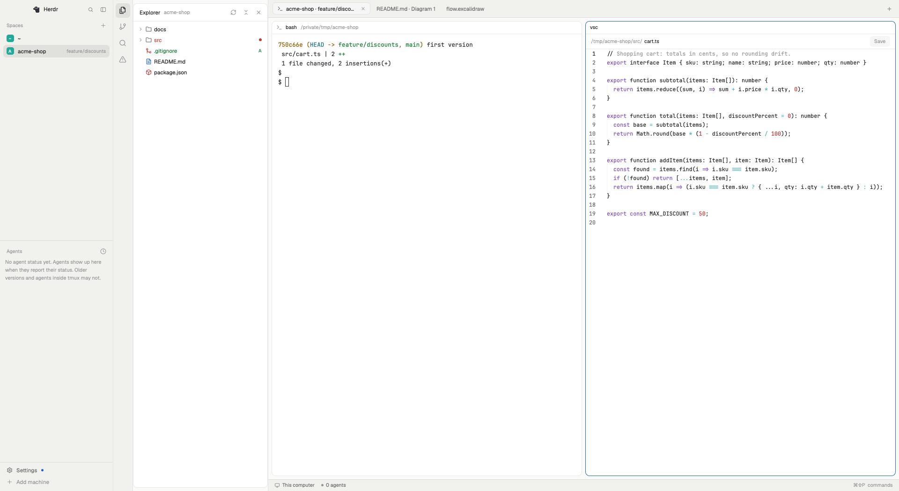

# Herdr Workbench

A [Herdr](https://herdr.dev) app layout with an editor workbench next to the sidebar, in the style of
VS Code (not affiliated with Microsoft or Visual Studio Code). **macOS and Linux only.**
Needs Herdr 0.1.14 or newer (the first PDF opened builds its viewer, which can take longer than
older versions let a program run).



Built so far:

- An activity rail with Explorer, Changes (Herdr's own Changes panel), Source Control, Search and Problems. The panel resizes, and folds to
  the rail when dragged narrow or when the shown view's icon is clicked.
- Explorer: file tree of the focused terminal's folder, file-type icons, git marks (folders take the
  strongest mark below them), and unsaved files and the folders that contain them marked in blue.
- Right-click in Explorer, as in VS Code: New File, New Folder, Rename, Delete (to the Trash, with
  a confirmation; on a machine without one, deleting for good asks a second time), Cut, Copy and
  Paste (a copy never replaces anything: it becomes "name copy"), Copy Path, Copy Relative Path,
  Reveal in Finder, Open in Integrated Terminal, Open to the Side, Find in Folder, and Select for
  Compare / Compare with Selected. Actions stay inside the Explorer's folder and never write
  through a symlink that leads out of it. A file with unsaved changes in its tab is not renamed,
  moved or deleted; tabs of moved files follow them. Each file has one editor: Open to the Side on a
  file that is already open shows that editor (VS Code would open a second view of it).
- Files open in their own tab: code with syntax colors, markdown with Preview/Edit, images.
  On macOS, PDFs show as pages (20 at a time, "Show more" for the next) and Word, RTF and
  OpenDocument files as read-only text with tables; headings from Word styles show as plain text.
  The pictures of a .docx or .odt file are listed under its text (up to 60, 20 MB each, 100 MB in
  all); each opens in its own tab. PDFs and documents open up to 50 MB, on this computer only.
  Mermaid diagrams (macOS): `.mmd` / `.mermaid` files open as Diagram (a picture) or Source (the
  text, editable); a Markdown preview lists its ```` ```mermaid ```` blocks, each opening as a
  picture in its own tab or to the side, drawn again when the file changes. draw.io files
  (`.drawio`, `.dio`, compressed or not) open the same way, with a button per page; shapes draw.io
  loads from its website (stencil libraries such as cloud provider icons) stay empty, because
  diagrams never load anything. `.drawio.svg` files already show as pictures.
  PlantUML files (`.puml`, `.plantuml`, `.pu`) open the same way when PlantUML is installed on this
  computer (`brew install plantuml`, which brings Java), else the tab says how to install it; they
  are never sent to a PlantUML server. Includes of other files or URLs are refused.
  Excalidraw files (`.excalidraw`) open the same way, drawn with Excalidraw's own library and its own
  fonts (Excalifont, Virgil and the others), pictures inside the drawing included; they are shown, not
  edited as drawings (Source edits the JSON). Files over 8 MB (drawings with many photos) open as too
  large. `.excalidraw.svg` / `.excalidraw.png` exports already show as pictures.
  Files a tab cannot show offer "Open in default app" for documents, images and media (PDF, Office
  files, audio, video), else "Reveal in Finder".
  `cmd-s` saves. A file changed elsewhere is never overwritten silently: you choose Compare,
  Use disk version or Keep mine.

- Source Control: changed files with line counts, changes against the last commit in a tab, commit,
  branches, and pull (fast-forward only) and push after a confirmation that names the branch, the
  remote and its address. Push never forces and pushes exactly one branch.
- **Secrets never leave your machine through this panel:** `.env` files, keys and other secret files
  are never committed (they are left out and can be added to `.gitignore` with one click), and a push
  is refused while commits not yet on the server contain one. `.env.example`-style templates are
  committed normally. "On the server" means what this clone last fetched from that remote: after a
  secret was purged from the server by a force-push, run `git fetch --prune` before pushing again.
  When the branch's remote is set as an address rather than a name, the branch's whole history is checked.
- Before commit, branch switch, pull or push, the panel lists programs the repository itself would run
  (hooks such as husky, signing programs, credential helpers, custom transport settings) and waits for
  Continue. Transport helpers that run programs (`ext::`, `fd::`), the repository's own upload-pack and
  receive-pack programs and submodule recursion are always switched off.

- Search (`cmd-shift-f`): text or a regular expression (JavaScript syntax) across the focused
  terminal's folder (the one Explorer shows), with match case and whole word. In a repository, files
  `.gitignore` excludes are left out unless you tick "Include ignored files". Files reached through a
  symlinked folder that points outside the folder are never searched or changed. Results show the line number; clicking one opens the file (Herdr's
  editor cannot jump to a line yet).
- Replace: shows every changed line per file before anything is written, lets you leave files out,
  skips files with unsaved changes in their tab or changed since the preview, and offers "Undo replace".
- Quick Open (`cmd-p`): type part of a file's name or path in the same folder; recently opened files come first.

- Problems (`cmd-shift-m`): errors and warnings from the folder's own TypeScript (`tsc`), ESLint and
  Ruff, grouped by file, with a count on the rail. Each one opens its file, or VS Code at its exact
  line ("Open in VS Code"). Checks run the project's own programs, so nothing runs until you trust
  the folder; the prompt lists each command. After that they run when you ask and after each save.
  Only tools the project installs are used (`node_modules/.bin`, `.venv/bin/ruff`, or Ruff on your
  PATH, shown and run by its full path), never `npx`. A tsconfig.json that only lists references
  (as Vite writes it) is checked through each referenced config inside the folder. Trust is kept
  for the folder's real path, its identity on disk and the exact commands: a different project
  unpacked at the same path, or a change in the checks (a pulled branch adds eslint), is asked about
  again. On Linux a folder made again at the same path can get the same identity back. Checks stop after 10 minutes, and when you focus a terminal in another
  folder. With `incremental` or `composite` in a tsconfig, tsc writes its `.tsbuildinfo` file.

- **Tab names**: terminal tabs are named after the agent in them and its folder ("Claude Code ·
  shop"), else their folder and git branch ("shop · main", "~" at home), and follow `cd`. A name you
  give a tab is kept; renaming it to nothing hands it back (typing exactly the automatic name counts
  as automatic). Editor and diagram tabs keep their file names. Only while this layout is shown: in
  another layout tabs keep the name they last had.

- **Herdr's main layout**: this layout is built from parts of Herdr's `main` layout, which Herdr
  replaces on updates. When `layouts/main.json` differs from the copy this mod follows
  (`mods/vsc/main-base.json`, key order ignored), you get one notice per changed version; clicking it
  opens both side by side, so you can see what to take over. It is read at start and every 10 minutes.
  Only the layout is compared: a change in one of Herdr's own mods, such as a renamed setting this
  layout passes but `main` does not, is not noticed.
  Missed the notice? Run `herdr-app do vsc.comparemain` while this layout is shown. After taking changes
  over into `layouts/workbench.json`, copy `layouts/main.json` to `mods/vsc/main-base.json`, so the
  difference is not told again.


It uses only its own mod (`vsc`) and Herdr's shipped mods, so Herdr updates keep arriving.
Look and feel follow [DESIGN.md](DESIGN.md).

## What it runs and writes

Herdr asks every shared mod to say this before it is installed.

- **Runs programs** (`exec`, on this computer or the space's machine): `sh` (folder listing and
  file checks), `wc`, `cksum`, `head`, `stat`, `readlink`, `base64` (reading files and images),
  `chmod` (its own folders), `mkdir`, `mv -n`, `cp -RP`, `trash` / `gio trash` and `rm -rf` (only
  Explorer's Delete for good, after two confirmations), `open -R` / `xdg-open` (Reveal in Finder),
  `grep` and `find` (Search and Quick Open), `git` (status, ls-files, rev-parse, config, diff,
  cat-file, rev-list, log, branch, remote, symbolic-ref; and add, reset, rm, commit, switch, pull
  and push when you click them, through `env` and your ssh for the network), `osascript` (Finder's
  Trash before macOS 15), `mktemp`, `chgrp`, `dirname`, `id`, `tr` and `find … -exec rm` (saving on
  another machine, removing its own stale temporary files), and, in folders you
  trust, the project's own `tsc`, `eslint` and `ruff` (Problems), in the background with their
  output in `vsc-cache/`, deleted once read; `pkill`, `kill` and `sleep` stop them, and `stat`,
  `command -v` and `grep` find them. "Open in VS Code" runs `code --goto`, or `open` (macOS) /
  `xdg-open` (Linux) with a `vscode://file` link when `code` is not on PATH.
  PDFs and documents (macOS): `xcode-select -p`, then once `swiftc` to build a small PDF page
  renderer into `vsc-tools/` and `mv` to put it in place; that renderer draws pages into
  `vsc-cache/`. `unzip -l` lists a .docx or .odt file's pictures (plain names in its media folder
  only), and `unzip -p … | head -c` copies each into `vsc-cache/`, cut off at 20 MB whatever the
  archive claims; a stored symlink is copied as its link text, never followed.
  `textutil` reads Word, RTF and OpenDocument files, always told the file's format,
  so an HTML file named `.docx` is refused rather than converted (converting would fetch its
  images). "Open in default app" runs `/usr/bin/open` (macOS) or `xdg-open` (Linux) on the
  file, only for document, image and media formats, never on an executable file or on a symlink to
  another kind of file. Office files (doc, docx, rtf, odt, xlsx, pptx) open in Word, Excel or
  LibreOffice, which can run macros (after their own prompt) and follow links in them; files from
  git or an archive carry no download mark, so Office's Protected View does not apply. `uname -s` tells macOS from Linux.
  Diagrams (macOS): once `swiftc` to build a small diagram renderer into `vsc-tools/`, which draws
  a diagram with the Mermaid, draw.io or Excalidraw library shipped in `vendor/` inside a windowless WebKit view
  that blocks every network and file load and has WebRTC switched off (WebKit keeps that blocking rule in
  `vsc-tools/webkit-rules/`),
  and writes the picture to `vsc-cache/`. The diagram's
  text is written next to it for the drawing and deleted after.
  PlantUML diagrams: the `plantuml` on your PATH (or in `/opt/homebrew/bin`, `/usr/local/bin`) is run
  with the diagram's text, in PlantUML's SANDBOX security profile (no includes of files or URLs).
  It runs Java and Graphviz `dot` on this computer, in an empty folder of its own in `vsc-cache/`
  that is removed after, and is stopped after 30 s. Use PlantUML 1.2023.9 or newer: older versions
  had ways around SANDBOX.
- **Runs `git status` automatically** in the focused terminal's folder to show git marks, as
  Herdr's own Files and Spaces do. A repository's own git configuration can name programs (filter
  drivers) that `git status` runs, so Explorer first reads the repository's settings, which runs
  nothing, and leaves git marks off when the repository defines such programs (the standard git-lfs
  filter commands excepted; git-lfs extensions are not).
  Submodules are not checked. Herdr's Spaces sidebar still runs `git status` in the same folder,
  so do not open folders containing a `.git` from archives you do not trust.
- **Finds programs on your PATH**, as Herdr runs them with your shell's environment: `git`, `sh`, `code`
  and the others run directly, not through a shell script, take the first match on your PATH. Its own
  shell scripts drop relative PATH entries first; the direct calls do not, so keep `.` (or an empty
  entry) off your PATH, or a program planted in a repository could run in place of `git`.
- **Writes your files** only when you save or confirm a Replace, through Herdr's `writeTextFile`,
  which refuses to overwrite a file that changed since it was read. Replace never writes through a
  symlink and leaves files over 1 MiB alone.
  On another machine (where `writeTextFile` does not work) the text goes over `exec` into a
  temporary file `.vsc-save.XXXXXX` beside the file (`mktemp`, readable only by you), which
  replaces the file only when the text arrived whole and the file still holds what was read; the
  file keeps its mode and group, and files owned by another user are not saved. The replacement is
  a new file, so hard links and ACLs are not carried over. Such temporary files are never
  committed, and leftovers over an hour old are removed at the next save in that folder. In a
  folder other users may write to without the sticky bit, they could interfere with a save, as
  they could with the file itself.
- **Writes under `~/.config/herdr-app`:**
  - `vsc-drafts/`: unsaved text of open files, so closing a tab or the app loses nothing.
    A draft is deleted when you save or discard, or at start-up once the file already holds that text.
    Secret files never get a draft: `.env*`, `.envrc`, keys and certificates, `*.tfvars`, `secrets.*`,
    everything in `.ssh`, `.aws`, `.kube`, `.docker`, `.gnupg`, any file reached through a symlink to
    one of those, and any file only its owner may read.
  - `vsc-cache/`: copies of images being previewed, pictures of PDF pages and documents' pictures (the app shows images
    only from its own folder), removed when their tab closes.
  - `vsc-tools/`: the PDF page renderer and the diagram renderer built from this mod's source,
    each rebuilt when its source changes.
  - In `shared.json` (Herdr's shared state), paths and counts only: `vsc.trusted` (folders you
    trusted for Problems), `vsc.recent` (recently opened files), `vsc.saved` (the last saved file),
    `vsc.problems` (the problem count), `vsc.tabs` and `vsc.dirty` (open tabs, unsaved files),
    `vsc.fileclip`, `vsc.compare-pick`, `vsc.search-scope` and `vsc.fs-changed` (Explorer's Cut/Copy,
    Select for Compare, Find in Folder, and a change counter), `vsc.autonames` (the tab names it gave,
    by tab id) and `vsc.main-seen` (a fingerprint of the last changed main layout it told you about).
  - These folders are readable only by you (mode 700) and contain a `.gitignore` of `*`, so a dotfiles
    repository does not pick them up.
- **Changes one Herdr setting**: it hides the Files/Changes buttons in the tab bar while this layout
  is shown and puts your previous setting back when you switch away.
- **No network access of its own.** Web links in markdown open in your browser only when clicked.
  Markdown previews load no images (they show as text) until you choose "Load images", so opening
  a file does not tell anyone that you read it.

## Install

Copy the layout and the mod into Herdr's home, check the mod, then switch to the layout:

```sh
git clone https://github.com/ivansolic/herdr-workbench
cd herdr-workbench
cp layouts/workbench.json ~/.config/herdr-app/layouts/
cp -R mods/vsc ~/.config/herdr-app/mods/
herdr-app check ~/.config/herdr-app/mods/vsc
herdr-app do layout.switch '{"name":"workbench"}'
```

Merge `keys.json` into `~/.config/herdr-app/keys.json` for the keys below (add its two sections; keep
your own keys where they differ). `ctrl-shift-l` switches back to your previous layout; deleting
`layouts/workbench.json` and `mods/vsc` removes it. Requires git 2.31 or newer for Source Control.

## Keys

`keys.json` holds the keys this package adds; merge it into yours. Panel keys apply only in this layout:
`cmd-shift-e` Explorer, `ctrl-shift-g` Source Control, `cmd-shift-f` Search, `cmd-shift-m` Problems,
`cmd-p` Quick Open (in place of Herdr's picker, which stays on `cmd-k`).
In an editor tab, `cmd-s` saves.

## Develop

```sh
./scripts/dev-link.sh                     # copy mods/ and layouts/ into ~/.config/herdr-app
herdr-app check mods/vsc                  # check the mod after each change
npm test                                  # tests for the pure helpers (Node 20+)
herdr-app do layout.switch '{"name":"workbench"}'
```

## License

MIT, see [LICENSE](LICENSE).

Third-party code and icons: see [THIRD-PARTY-NOTICES.md](THIRD-PARTY-NOTICES.md).
