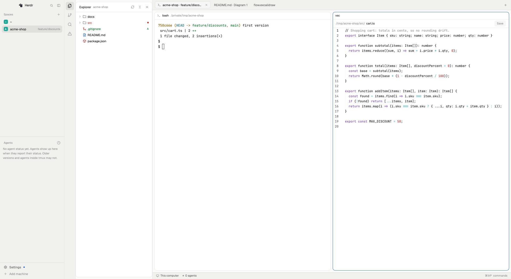

# Herdr Workspace Studio

Two mods that make Herdr an editor workbench for coding agents. `vsc` adds an activity rail in the style of
VS Code, with Explorer, Source Control, Search and Problems, and opens files, diffs, PDFs, documents and
diagrams in Herdr's own tabs next to your terminals and agents. `ai-usage` adds an AI usage panel
(subscriptions, limits and cost per project for Claude Code, Gemini CLI and Codex) and turns every pane
header into an agent tracker: the agent's plan, limits, memory, cost and tasks, fitted to the pane's width.
The repository also ships the `workspace-studio` layout, which places both; you can add them to your own
layout instead (see Built from).



**Before adding it:** both mods run programs (`exec`, `hc read`) and read files outside their own folders
(your project folders, and the agents' logs under `~/.claude`, `~/.gemini` and `~/.codex`), and `ai-usage`
downloads the ECB's public daily euro rate. Details under Built from; the full list is in `docs/security.md`.

## What you see

Left to right, on the theme's `canvas` background, the system title bar hidden (`titlebar: "none"`, window
buttons at 12, 16):

- **Sidebar**, 268 px (`chrome`, fixed width, 44 to 480): Herdr's brand bar (46 px, drags the window), the
  Spaces list and the Agents list (half each, at least 90 px), and the sidebar footer (69 px).
- **Activity rail**, 46 px (`chrome`): six 34 px icon buttons, Explorer (files), Changes (Herdr's own
  Changes panel, file-diff icon), Source Control (git branch), Search, Problems (triangle with a count badge: red with errors, the warning color with warnings
  only) and AI usage (gauge). The shown view's icon has the `selected` background.
- **Views panel**, 320 px (60 to 900, 8 px top and bottom padding): one of Explorer, Changes, Source Control,
  Search, Problems or AI usage. Panels follow Herdr's own Files/Changes look: `background` body, 10 px corners, 42 px header
  with a 13 px semibold title, 28 px rows with 7 px corners.
- **Work area**: Herdr's tab bar (42 px, drags the window), the shown tab with 8 px padding and gaps (pane
  cards on `background` with a 1 px `border`, `accent` when focused, 10 px corners, the agent tracker
  header on top), and Herdr's status bar (28 px).
- **Agent tracker header** (`ai-usage`), on every pane:
  - **Title row**, 18 px: the program's icon and name, the project and git branch in `muted`; on the right a
    spinning icon (`working`) while the agent works, a "Needs you" chip (`blocked` on a tinted background)
    when it waits, a 7 px `done` dot when it finished.
  - **Usage**, 17 px rows, 12 px text, labels semibold in `ansi3`: `Plan` and the plan name in `accent`; each
    limit (`5-hour limit`, `Weekly limit`, or `Daily limit` for Gemini) as a 5 px bar on `raised`, its
    percent and "· resets 13:00" in `muted`; `Memory` with a bar and "· 370k of 1.0M tokens"; `Cost $18.40 at
    API price`. Parts are separated by `│` in `border`. Limit and memory bars are `accent`, `blocked` from
    70%, `ansi1` from 90%.
  - **Tasks**: a braille spinner in `working` while the agent works (a check when all are done), `Tasks`, a
    56 px bar (`done` when complete), `2/5`, "· now: <task>", "· 2 subagents running", and an **All tasks ›**
    pill on `raised`.
  - **Forms by width**: wide, usage and tasks on one row (header 44 px); narrower, usage on two rows and the
    tasks as a badge beside the title (64 px); narrower still, short labels (`5h`, `Week`, `Mem`, "↻13:00")
    on as many rows as needed (83, 102, 121 px ...); below 260 px no reset times and 28 px bars. Folded,
    the title row and the tasks badge alone (26 px).
  - Panes without an agent: the program name and folder; an agent it can't read: "its usage isn't read yet".
- **AI usage panel** (`ai-usage`, in the views panel): subscription cards (plan, 5-hour and weekly limits with
  reset times, whether the plan beats paying per token), cost for Today / Week / Month / Projected / 30 days
  (More ▾: 60 days, 6 months, year, all time) with a bar chart by day and what the prompt cache saved,
  projects (click: budget, git branches as features, models and subagents inside), models compared, a
  USD/EUR choice and Export CSV; light-blue "i" boxes explain each figure.

Editor tabs are Herdr tabs whose only pane is the mod: a 36 px toolbar (file path, Diagram | Source or
Preview | Edit segments, Save) above the content.

## How it behaves

- **Rail**: a click shows that view; clicking the shown view's icon folds the panel to the rail; dragging
  the panel narrower than 150 px folds it and it comes back at its last width. While this layout shows,
  Herdr's Files/Changes tab-bar buttons are hidden; the previous setting returns when you switch away.
- **Explorer**: the focused terminal's folder as a tree with file-type icons, git marks (folders take the
  strongest mark below them) and unsaved files in `ansi4`. Right-click: New File/Folder, Rename, Delete (to
  the Trash, confirmed), Cut/Copy/Paste (never replaces: "name copy"), Copy Path / Relative Path, Reveal in
  Finder, Open in Integrated Terminal, Open to the Side, Find in Folder, Select for Compare / Compare with
  Selected. Actions stay inside the folder and never write through a symlink that leads out of it.
- **Files** open in their own tab (one per file; opening again focuses it): code with syntax colors (edit
  up to 1 MB, read-only up to 20 MB), Markdown Preview/Edit, images; on macOS PDFs as pages (20 at a time)
  or selectable text (with OCR for scanned pages), Word/RTF/OpenDocument as read-only text with their
  pictures listed below. `cmd-s` saves; a file changed on disk meanwhile is not overwritten without asking;
  unsaved text survives closing the tab.
- **Diagrams** (macOS): Mermaid (`.mmd`, and each ```` ```mermaid ```` block of a Markdown preview), draw.io
  (a button per page), Excalidraw (`.excalidraw`, with its own fonts and pictures) and PlantUML (`.puml`,
  only with a local `plantuml`) open as Diagram or Source and are drawn again when the file changes.
- **Source Control**: changed files with line counts, changes against the last commit in a tab, commit,
  branches, pull (fast-forward only) and push after a confirmation naming the branch and remote.
- **Search**: text in the folder, with a multi-file replace that shows a preview first. `cmd-p` Quick Open.
- **Problems**: tsc, eslint and ruff results, after the folder is trusted once; Open in VS Code per item.
- **Agents**: their status shows in Herdr's own sidebar, tabs and pane headers (working, blocked, done,
  idle), unchanged. Terminal tabs are named "Claude Code · folder" while an agent runs in them, else
  "folder · branch" ("~" at home); a name you give a tab is kept.
- **Herdr's main layout**: when Herdr's shipped `main` layout differs from the copy this layout follows, one
  notice per changed version; clicking it opens both side by side.
- **Other machines**: a file of a space on another machine opens and saves (text over `exec`, about
  500 KB at most); a file changed there meanwhile is not overwritten.

- **Agent header buttons**: on hover, top right: Fold (double arrow), Split right, Split down, Zoom, Close.
  Fold shrinks every pane header to its title row and task count, and again unfolds them; it applies to all
  panes, as Herdr gives a layout's pane headers one height. A click elsewhere on a header focuses its pane.
- **Agent header height**: the first pane of the shown tab sets the layout's header height to what the tallest
  header in the tab needs, once the panes have asked for the same height for one second, so dragging a
  divider resizes the terminals once. Folding applies at once.
- **All tasks ›** (or the Tasks badge): a 560 × 520 window with usage, the model, every task (open first, done
  ones struck through, after three folded behind "… +N completed") and every subagent with its type, model,
  tool calls, time and a steps bar. It closes itself when its pane closes.
- **Live data**: a header reads its agent's newest session log every 3 s while it works (every 15 s
  otherwise); Gemini's plan and daily limit appear after `/stats` ran in its pane.
- **AI usage panel**: reads every agent's logs at start and when they change; a budget warns once at 80% and
  once at 100% of the month; Export CSV writes the shown period to Downloads with $ and € columns.

## Built from

- `layouts/workspace-studio.json`: root row → `sidebar` column (`brand` block `workspace-chrome`, `sidebar-lists`
  column with `spaces` and `agents` blocks, `sidebar-footer` block `workspace-chrome` with
  `{"footer": true}`), `vsc-activity` block (`vsc`, `{"view": "activity"}`), `vsc-views` stack (`vsc` blocks
  `{"view": "explorer" | "scm" | "search" | "problems"}` and Herdr's `changes` block), `work` column (`tabs` block
  `tabs`, `work-body` row with the `{"tab": "active"}` block and its pane frame, `status` block
  `workspace-status`). The `vsc-views` stack also holds `vsc-usage` (`ai-usage`); the pane frame's header
  is `{"content": {"mod": "ai-usage"}, "height": 64, "position": "top", "reveal": "always"}`.
- **In your own layout instead:** add a block `{"mod": "vsc", "props": {"view": "activity"}}` and a stack with
  id `vsc-views` holding the view blocks with the ids above (the rail selects children by these ids); set the
  tab block's pane header to `{"content": {"mod": "ai-usage"}, "height": 64}`; add `{"mod": "ai-usage"}` as a
  block or stack child for the panel. Move `keys.json`'s `layout:workspace-studio` keys to your layout's
  section.
- Shipped mods used as they are: `workspace-chrome`, `spaces`, `agents`, `tabs`, `workspace-status`,
  `changes`.
- One mod, `mods/vsc`: `main.js` picks the view by `props.view`; editor, diagram, diff and compare tabs are
  opened with `herdr-app do tab.new {mod, props}`. Pure logic lives in `lib/` with node tests in `tests/`.
- `herdr` functions: `exec`, `readTextFile`, `writeTextFile`, `watchFolder`, `spaces`, `panes`, `agents`,
  `machines`, `knownAgents`, `shared`/`setShared`, `notify`, `run` (`layout.select/show/hide/resize`,
  `tab.new`, `tab.rename`, `pane.split`).
- Programs it runs: git, grep, find, sh, the project's own tsc/eslint/ruff (after trust), `textutil`,
  `unzip`, `swiftc` once to build a PDF renderer and a diagram renderer (WebKit, every load blocked),
  `plantuml` when installed, `open`/`xdg-open`.
- `mods/ai-usage`: `main.js` is the panel; with `props.pane` (a pane header) or `props.view == "agent"` (the
  task window) it draws `header.js`. `scan.mjs` (Node 20+) reads `~/.claude/projects/**/*.jsonl` and the
  Claude Code tracker's snapshots, `~/.gemini/tmp/*/chats`, `~/.codex/sessions/**` and only the
  `chatgpt_plan_type` field of `~/.codex/auth.json`, caching figures in `data/ai-usage/cache.json`; headers
  run `node scan.mjs --live <agent> <folder>` and, for Gemini, `hc read` of the pane, keeping only the Tier
  and "% used" lines. `fetch` of `https://www.ecb.europa.eu/stats/eurofxref/eurofxref-daily.xml`. Header
  height through `layout()` and `layout.set`, changing only `pane.header.height` of headers it draws.
  Shared state keys `ai-usage.*`. Pure logic in `lib/` (`usage.js`, `live.js`, `fit.js`) with node tests.
- Vendored libraries in `mods/vsc/vendor/` (Mermaid, draw.io viewer, Excalidraw utils), unchanged except
  Excalidraw's Liberation Sans font (taken out by `scripts/vendor-excalidraw.mjs`); own icon set in
  `mods/vsc/icons/`.
- `keys.json`: `layout:workspace-studio` (`cmd-shift-e` Explorer, `ctrl-shift-g` Source Control, `cmd-shift-f`
  Search, `cmd-shift-m` Problems, `cmd-p` Quick Open) and `mod:vsc` (`cmd-s` save).

## Watch out

- `run()` returns nothing to mods: tabs are opened with `herdr-app do tab.new` to learn their id.
- `image()` reads only the app's folder: images, PDF pages and diagrams are copied or drawn into
  `vsc-cache/` first. `exec` output stops at 8 MiB, hence the read-only and remote size limits.
- There is no close-tab veto: unsaved text is kept as drafts and restored.
- BSD and GNU tools differ (`chmod --`, `stat -f`/`-c`): every argument list is in `lib/scripts.js` and
  tested with the real program.
- Herdr marks every renamed tab as named, so the tab names the mod gave are remembered in shared state.
- PDF, document and diagram viewers are macOS only (PDFKit, textutil, WebKit through `swiftc`, which needs
  the Xcode command line tools); a first `swiftc` build can take ~30 s.
- Mod commands (`vsc.comparemain`) reach shown copies only.

- Herdr gives every pane header in a layout one height: a fold per pane is not possible, and one narrow
  agent pane makes its neighbours' headers taller too.
- Values a mod writes on `this` while rendering don't last: the header works out and applies its height on a
  timer.
- A `truncate()`d text doesn't shrink below its content in a row: on one row, "now: <task>" gets an explicit
  max width, or All tasks is pushed off the edge.
- A burst of terminal resizes can garble Claude Code's screen (ctrl+l redraws it): one height change per
  settle.
- Codex shows tokens without $ (no OpenAI prices yet).

## Done when

- `herdr-app check` passes for `mods/vsc` and `mods/ai-usage`, and `npm test` passes (Node 20+).
- Switching to `workspace-studio` shows sidebar, rail, panel, tabs and status bar as above; the rail folds and
  restores the panel; Herdr's Files/Changes buttons come back after switching away.
- Explorer lists the focused terminal's folder; a file opens in its own tab, edits save with `cmd-s`.
- A PDF shows pages, a `.mmd` file draws, an `.excalidraw` file draws with its fonts and pictures.
- Source Control shows a diff; Search finds text; Problems lists tsc errors after trusting the folder.
- A new terminal tab is named after its folder and follows `cd`; a hand-given name stays.
- A pane running Claude Code shows its plan, limits with reset times, memory, cost and task count, with a
  spinner while it works; made narrow, its usage wraps onto more rows with nothing cut off and the header
  grows about a second later; widened, it returns to one row.
- Fold shrinks every header to its title row; All tasks › opens the task window, which closes with its pane.
- The gauge icon shows the AI usage panel; `node scripts/ai-usage-demo.mjs` fills it and any pane whose folder
  ends in `/acme-shop` with made-up data, and `--off` returns to real data.
